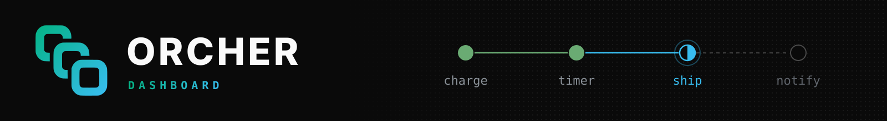
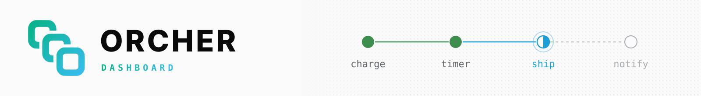

<p>
  
  
</p>

<p align="center"><sub>See every workflow the engine runs, from the engine itself.</sub></p>

<br />

<div>
  <a href="https://github.com/orcher-io/ui/releases/latest"></a>
  <a href="https://github.com/orcher-io/ui/actions/workflows/ci.yml"></a>
  <a href="./LICENSE"></a>
</div>

<br />

The ORCHER dashboard is static files the engine serves on its HTTP port, beside
its REST API. It has no server of its own: it calls the engine from the browser.

-  **Workflows**: list and filter runs; open one for its tasks, timeline, graph, journal and logs
-  **Schedules**: create, pause, resume and delete, with each schedule's runs
-  **Workers**: who is connected, their host and resources, and when each last checked in
-  **Namespaces and batch operations**: manage both from the same shell
-  **Sign-in**: asks for an API key only when the engine requires one
-  **Tabs and splits**: built on [Workbench](https://github.com/orcher-io/workbench), with a command palette

<br />

###  Use it

Open the engine's HTTP address, `http://localhost:8080` by default. The engine (0.7.0 or
later) serves the files in `ui.dir`, `/usr/share/orcher/ui` unless set; `--no-ui` turns
it off. To serve a release yourself:

```bash
gh release download v0.2.1 --repo orcher-io/ui -p 'orcher-ui-*'
sha256sum -c orcher-ui-0.2.1.tar.gz.sha256
gh attestation verify orcher-ui-0.2.1.tar.gz --repo orcher-io/ui
tar -xzf orcher-ui-0.2.1.tar.gz
ORCHER_UI_DIR=$PWD/orcher-ui-0.2.1 orchestrator
```

> [!NOTE]
> When the engine requires a credential, the dashboard asks for an API key
> (`orcher api-key create`) and keeps it in this browser until you sign out. The
> files themselves are public; the engine decides what a key may see.

<br />

###  Development

```bash
pnpm install
ORCHER_ENGINE_URL=http://localhost:8080 pnpm dev   # http://localhost:3000
```

`pnpm dev` proxies `/api/v1` to the engine, as if the engine served the page.
`pnpm build` writes the static files to `out/`, plus
`out/_next/static/third-party-notices.txt`: the licence of every package in the
bundle. A licence not on `ALLOWED_LICENSES` in `next.config.js` fails the build.

To work on Workbench at the same time, point `WORKBENCH_DIR` at a checkout and its
sources replace the npm packages:

```bash
git clone https://github.com/orcher-io/workbench.git ../workbench
(cd ../workbench && pnpm install)
WORKBENCH_DIR=../workbench pnpm dev
```

<br />

###  How it reaches the engine

The data hooks request the dashboard's `/api/*` routes through `apiFetch`
([`src/lib/api-transport.ts`](src/lib/api-transport.ts)). This dashboard answers
them in the browser ([`src/lib/engine-routes.ts`](src/lib/engine-routes.ts)) by
calling the engine's REST API, same-origin, with the signed-in key as a Bearer
token. An app that embeds these components and serves `/api/*` itself keeps the
default transport, plain `fetch`.

<br />

###  Releasing

Bump `version` in `package.json` in a pull request, merge it, then push the tag:

```bash
git tag v0.2.2 && git push origin v0.2.2
```

The Release workflow publishes `orcher-ui-<version>.tar.gz` (the static files,
`LICENSE` and `THIRD_PARTY_NOTICES`), built reproducibly, with its SHA-256 and a
build-provenance attestation. The engine image pins a release of it.

<br />

###  Contributing

Issues and pull requests are welcome. CI typechecks and builds every pull request,
the build checking every bundled licence; run `pnpm build` before proposing a change.

###  License

Licensed under the [Apache License, Version 2.0](LICENSE).
